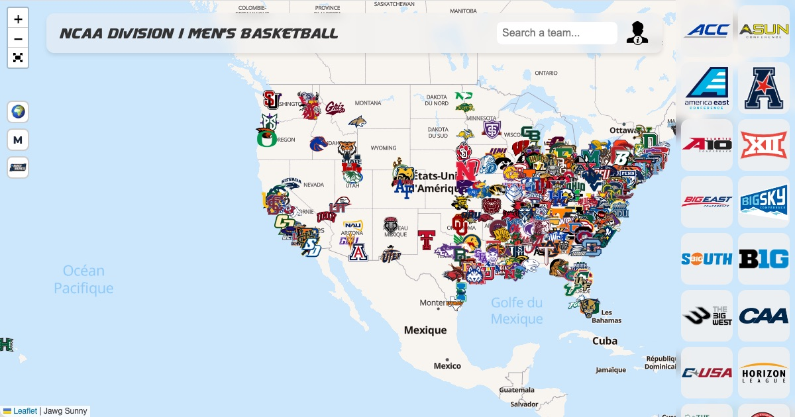

# Interactive Basketball Map — NCAA, French LNB, EuroLeague, EuroCup & Liga ACB

### 👉 **[Open the live map](https://nywes.github.io/NCAA-Men-s-Basketball-Interactive-Map/)**

[](https://nywes.github.io/NCAA-Men-s-Basketball-Interactive-Map/)

An interactive map of **every NCAA Division I men's and women's college basketball team**, every **French professional club** (Betclic ÉLITE, ÉLITE 2, Wonderligue, LF2), every **EuroLeague** and **EuroCup** team and the 18 **Liga ACB** clubs: rosters, player stats, standings, arenas, NBA/WNBA legends, honours and the full **March Madness** bracket history.

Carte interactive (Leaflet) des programmes de basket NCAA D1 (hommes et femmes), des clubs pro français, de l'EuroLeague, de l'EuroCup et de la Liga ACB : chaque équipe est un marqueur sur la carte, avec son roster, son classement et ses joueurs notables (anciens passés en NBA, palmarès…).

App **React** (Create React App) + **react-leaflet**, déployée sur GitHub Pages.

## Structure du dépôt

- Branche **`main`** : le code source (`src/`, `public/`, `package.json`).
- Branche **`gh-pages`** : uniquement le build déployé (généré automatiquement par `npm run deploy`, ne pas éditer à la main).

## Lancer en local

Prérequis : [Node.js](https://nodejs.org/) (≥ 16) et npm.

```bash
npm install     # installer les dépendances
npm start       # démarrer en mode dev (rechargement à chaud)
```

L'app s'ouvre sur **http://localhost:3000**.

## Autres commandes

```bash
npm run build    # build de production dans build/
npm run deploy   # build + publication sur la branche gh-pages (GitHub Pages)
npm test         # tests
```

## Données & documentation

Les données vivent dans [src/teams.json](src/teams.json) (les 364 facs, leurs coordonnées, rosters et joueurs notables). Le dossier [documentation/](documentation/) regroupe les notes de travail : critères de sélection des joueurs, rapport d'erreurs des données, roadmap, et catalogue des badges/trophées.
